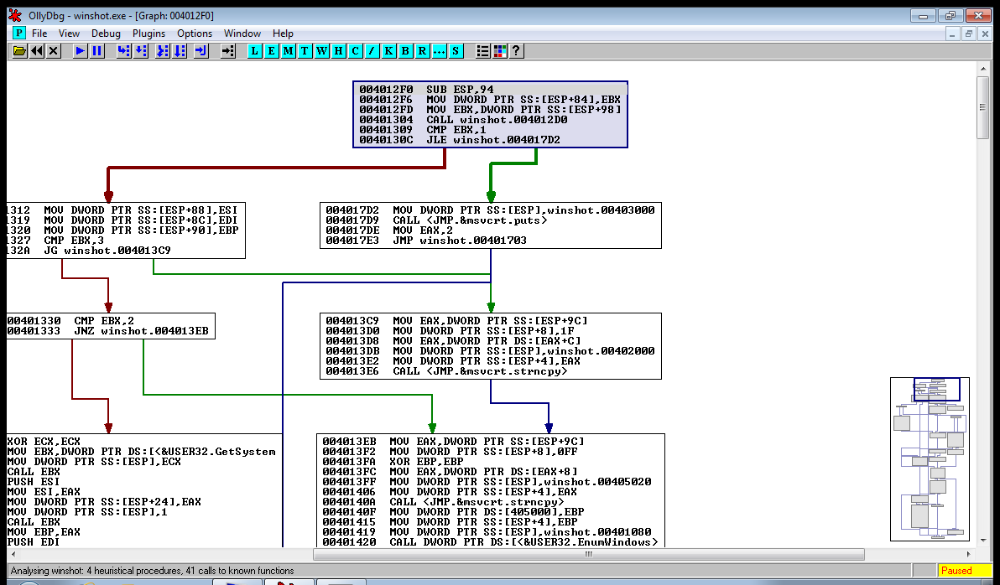
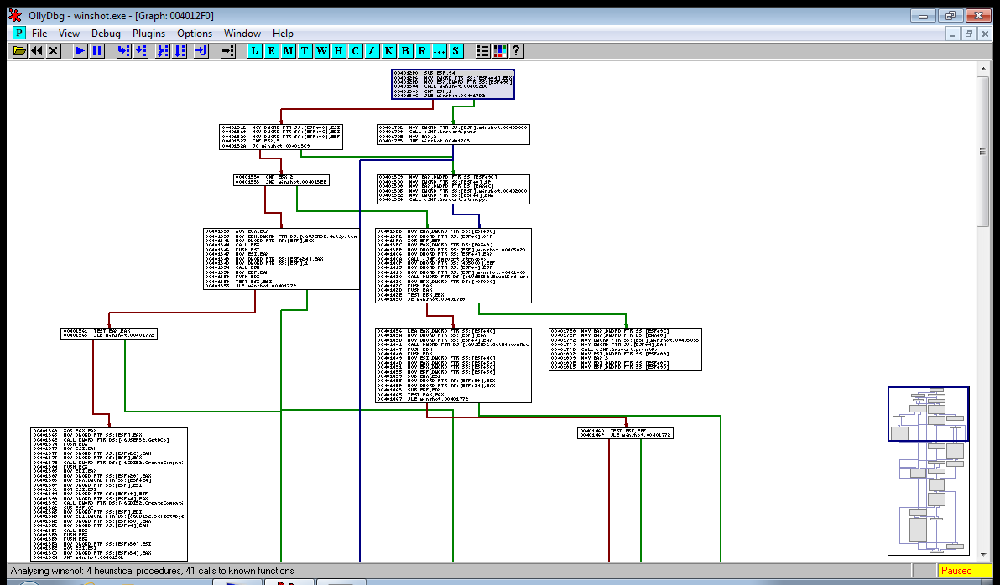
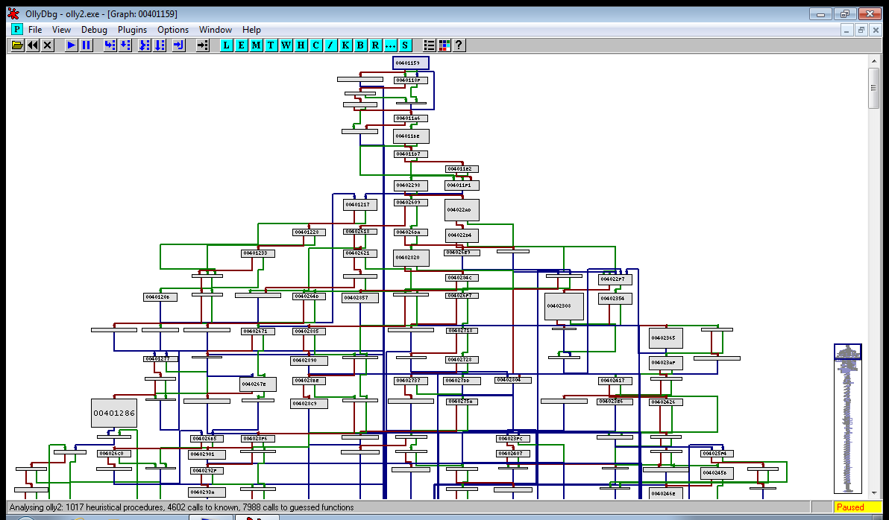

# GraphOlly

A control-flow graph view for **OllyDbg 1.10**. Put the cursor inside a
function in the Disassembler, press Ctrl+D, and the function opens as a graph
of basic blocks in an MDI window inside Olly, drawn with Olly's own font and
colours. The graph follows the debugger: the block holding EIP is marked at
every pause, breakpoints show up as Olly marks them, and you can step, set
breakpoints and follow calls without leaving the graph.

OllyDbg 1.10 never had a graph view of its own, and I wanted one that lives
inside the debugger instead of in a separate disassembler. GraphOlly is a single
32-bit DLL with no dependencies beyond what Windows XP already ships.



| 45%: text kept down to 5-pixel lines | 15%: a 599-block function as an overview, with the minimap |
|---|---|
|  |  |

## Features

**Opening a graph**

- **Ctrl+D** in the Disassembler, or right-click > GraphOlly > Graph function,
  or Plugins > GraphOlly > Graph current function.
- Not Ctrl+G: that is Olly's "Go to expression" and Olly never passes it to
  plugins. Ctrl+Shift+G does not work either, Olly ignores the Shift and opens
  its own dialog. The free Ctrl letters in 1.10 are D H I M P Q U V W X Y Z;
  pick another one with `Shortcut=` in the ini (see [Settings](#settings)).
- Asking again for the same function reuses the open window and highlights the
  block of the selected address.
- If the module is not analysed yet, the plugin runs Olly's analysis (the same
  as Ctrl+A) before building the graph.

**Moving around**

| Input | Action |
|---|---|
| left or middle drag | pan |
| wheel / Shift+wheel | scroll vertically / horizontally |
| Ctrl+wheel | zoom on the point under the mouse (15% to 400%) |
| `+` `-` | zoom in / out |
| `0` | 100% |
| End | fit the whole function in the window (the window opens fitted) |
| Home | go to the function entry |
| Up / Down | move the line cursor; with Ctrl they move the view |
| Left / Right, PgUp / PgDn | move the view |
| `M` | minimap on/off; click or drag inside it to move |
| hover | lightens the block under the mouse |
| click | selects the block and the line; the selected block's edges are drawn thicker and on top |

When a text line would be shorter than 5 pixels on screen, the graph switches
to an overview: solid blocks labelled only with their address.

**Debugging in the graph**

| Input | Action |
|---|---|
| Enter | follow what is under the cursor: on a CALL, inline the callee and go there; on a jump, go to the target block |
| Backspace | go back (32-step history) |
| `*` or Space | back to the current instruction (EIP) |
| F2 | toggle a breakpoint on the cursor line |
| double-click on a CALL line | inline the called function into the same graph, with a dashed grey edge from the call site (up to 64 functions) |
| double-click elsewhere | show that line in the CPU window |
| Ctrl+C | copy the selected block as text |
| right-click | context menu with all of the above, plus export |

- At every pause the block holding EIP gets a red border and its line is
  highlighted. With *Follow EIP* on, the view scrolls to it.
- When execution enters a different function, the graph is rebuilt there, in
  the same window (*FollowFunction*, on by default).
- Breakpoints set from the Disassembler or anywhere else show up within 400 ms;
  a timer watches a checksum of Olly's breakpoint table and repaints only when
  it changes.

**Search and export**

- **Ctrl+F** searches the lines of the graph (address, mnemonic, operand, case
  insensitive). **F3** / **Shift+F3** (or Ctrl+L / Ctrl+Shift+L) go to the
  next / previous hit in address order. Esc clears the marks.
- **Export as BMP** (context menu or Plugins menu): the whole graph as a 24-bit
  BMP, at 100% when it fits in 16384 pixels per side and 16 Mpixel, scaled down
  otherwise.

**Reading the edges**

Green = conditional jump taken, red = not taken, blue = unconditional jump or
fall-through, dashed grey = inlined call. Position carries the same
information: from a conditional jump the false branch always leaves on the
left and the true branch on the right. `Labels=1` adds T/F letters.

A note "unresolved exit" under a block means the graph stops there (`jmp eax`,
a jump table Olly did not recognise). The window title says `[truncated]` when
a hard cap was hit and `[no procedure]` when Olly does not know where the
function starts and ends.

## Settings

In `ollydbg.ini`, section `[Plugin GraphOlly]` (Olly's own naming for plugin
sections). All keys are optional.

| Key | Default | Meaning |
|---|---|---|
| `Shortcut` | `Ctrl+D` | key that opens the graph from the Disassembler |
| `FollowEIP` | `1` | scroll the view to EIP at every pause (also in the menus) |
| `FollowFunction` | `1` | rebuild the graph when execution enters another function |
| `Minimap` | `1` | minimap in the corner (also the `M` key) |
| `Labels` | `0` | T/F letters on conditional edges |
| `Trace` | `0` | write `grapholly-trace.txt` next to OLLYDBG.EXE: loading, function bounds, blocks and edges found, build/layout/paint times |

Plugins > GraphOlly > Diagnostics writes to Olly's log whether the module is
analysed and how many procedures Olly sees. That answers most cases of a graph
not looking as expected.

[`docs/OLLYDBG-INI.md`](docs/OLLYDBG-INI.md) is a separate write-up of which
of Olly's own ini keys 1.10 really reads; [`ini/`](ini/) has a recommended
`ollydbg.ini` for vanilla 1.10 built from it.

## Installing

Download `GraphOlly.dll` from the releases page.

**Vanilla OllyDbg 1.10.** Copy `GraphOlly.dll` into the folder set as
*Options > Appearance > Directories > Plugin path* (by default Olly's own
folder) and restart Olly. A *GraphOlly* entry appears in the Plugins menu.
Olly 1.10 does not draw the line from a selected jump to its target unless the
jump-path options are on; the four lines are listed in
[`docs/OLLYDBG-INI.md`](docs/OLLYDBG-INI.md).

**R4ndom's OllyDbg build.** Copy `GraphOlly.dll` into its `Plugin\` folder.
Check that *Plugin path* in its `ollydbg.ini` points to a folder that exists on
your machine: the build ships with the author's desktop path, and with an
invalid plugin path it loads no plugins at all, not even its own 19. One more
quirk of that build: right after loading, the main module is not registered
(empty name, codebase 0), so there is nothing to analyse and the graph comes
out `[no procedure]`. Run to the entry point (F9) and ask again. Details in
[`docs/R4NDOM.md`](docs/R4NDOM.md) and [`docs/NOTES.md`](docs/NOTES.md) §7.

On either build Olly may stop at the system breakpoint in ntdll first; F9 gets
you to the entry point.

## Compatibility

Tested on a Windows 7 SP1 x64 VM (32-bit OllyDbg under WOW64) and under wine 11
on Linux. The DLL should also load on XP, since it imports nothing newer than
`msvcrt.dll`, `kernel32`, `user32`, `gdi32` and `comdlg32`, but I have not run
it there. OllyDbg 1.10 is a 32-bit
debugger, so only 32-bit targets. OllyDbg 2.x has a different plugin API and is
not supported.

## Building from source

On Linux with mingw-w64 (Arch: `mingw-w64-gcc`, Debian/Ubuntu:
`gcc-mingw-w64-i686`):

```sh
bash build/build.sh          # -> build/out/GraphOlly.dll (+ test executables)
bash build/bench/bench.sh    # layout bench on the host, plain gcc
```

`build.sh` regenerates the import library for OLLYDBG.EXE from the PDK's
`Ollydbg.def` with dlltool (the PDK's own `.lib` is MSVC 5 COFF), compiles the
four C files, and checks that every export is by name.

No UCRT. Current mingw-w64 links against the Universal CRT
(`api-ms-win-crt-*.dll`) by default. Those DLLs are missing on an unpatched
Windows 7 or XP, and there the DLL failed to load without any message from
Olly; under wine nothing showed, because wine has the UCRT. So the build uses
`-nostdlib -nostartfiles`, enters straight at `DllMain` and links
`msvcrt.dll`, which every Windows since 95 has. `build.sh` fails if a UCRT
import ever comes back.

`build/make-dist.sh` builds two ready-to-run zips (OllyDbg plus the plugin,
the recommended ini and a sample target). It needs the two OllyDbg
distributions in `tools/odbg110/` and `tools/r4ndom/`, which are not in this
repository.

Testing: `build/ollyqa.exe` drives Olly from inside wine or a Windows VM
through a hidden QA window in the plugin (the command list is at the top of
`build/ollyqa.c`), and `build/qa-wine.sh` is a smoke test of the vanilla
package under wine: graph of `sample\winshot.exe`'s main at 004012F0, inline a
call, zoom 100/45/15, search, export, minimap, with screenshots.

## Limits

- **One function per graph**, plus the callees you inline by hand. There is no
  whole-module or call-graph view. That is on purpose: a single function of
  OLLYDBG.EXE (00401159, 599 blocks, 983 edges) already lays out at 5425x39164
  pixels.
- **Hard caps** (`src/grapholly.h`): 2048 blocks (`GO_MAXBLOCKS`), 4096 edges,
  256 KB of code scanned per function (`GO_MAXCODE`), 128 text lines per block
  (`GO_MAXLINES`), 64 inlined functions (`GO_MAXFUNCS`), 1024 switch cases per
  scan. Hitting one marks the graph `[truncated]`; it never crashes Olly.
- **Not resolved**: indirect jumps (`jmp eax`, `jmp [eax*4+table]`) unless Olly
  itself recognised the switch; indirect calls (`call eax`, `call [esi+8]`)
  cannot be inlined, double-clicking them only moves the CPU window.
  Non-returning calls (`exit`, `ExitProcess`, `abort`, `longjmp`...) are
  recognised by the name Olly prints in the instruction, so a stripped,
  statically linked `exit` falls through into whatever follows it.
- **Depends on Olly's analysis** for function bounds. On obfuscated or packed
  code the bounds can be wrong; the caps keep the descent from running away
  but the graph will be partial.
- **Edge routing**: each channel and corridor has eight lanes. Past the eighth
  edge in the same corridor lanes repeat and two polylines can overlap.

## How it works

1. `src/cfg.c`: recursive descent from the function entry over Olly's own
   disassembler (`Disasm` on memory read with `MM_RESTORE`, so breakpoints are
   invisible), splitting at every jump target; switch cases come from Olly's
   jump table data.
2. `src/layout.c`: layered layout. Levels by longest path from the entry
   (back edges ignored), dummy nodes for edges spanning up to 8 levels,
   barycentre ordering level by level keeping the order with the fewest
   crossings, fall-throughs kept in their predecessor's column.
3. Blocks are aligned on a shared grid, which leaves vertical corridors and
   horizontal channels; every edge gets its own lane, so no edge crosses a block.
4. `src/graphwnd.c`: plain GDI into a back buffer kept between paints, the
   layout stays in graph pixels and zoom applies only at paint time.

[`docs/NOTES.md`](docs/NOTES.md) collects the OllyDbg 1.10 pitfalls I ran into
while writing it (export names, struct packing, procedure bounds, input under
wine), with numbered sections cited from the source.

## Credits and license

OllyDbg is by Oleh Yuschuk. `src/plugin.h` and `build/Ollydbg.def` come from
the OllyDbg 1.10 Plugin Development Kit and are included under its terms
(distributed "as is", see the header of `src/plugin.h`).

GraphOlly is by Emanuele Lovato, released under the [MIT license](LICENSE).
